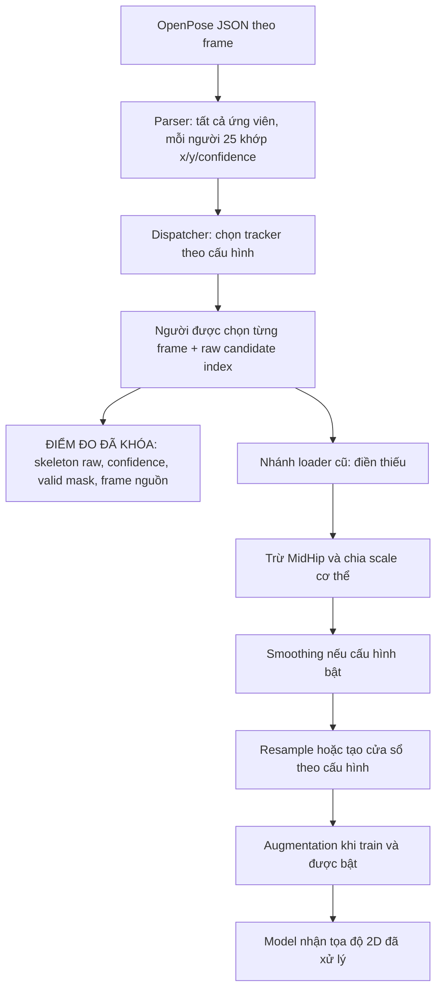

# Rà soát và khóa pipeline MMASD v0.1

**Ngày thực hiện:** 18/10/2026.
**Phạm vi:** bước 1 — đọc code, đối chiếu artifact và khóa cách quan sát skeleton. Chưa chọn pilot 20–50 clip, chưa triển khai detector/correction và chưa huấn luyện lại mô hình.

## 1. Kết luận và cấu hình đã chốt

Đã xác định được luồng dữ liệu thực tế, kiểm tra trên 3 clip thật / 470 frame và lưu [cấu hình độc lập `skeleton_audit_v0_1.yaml`](../../BiLSTM/configs/skeleton_audit_v0_1.yaml). Đợt khảo sát tiếp theo dùng **OpenPose BODY_25 2D + Tracklet V2**, giữ nguyên X/Y/confidence của ứng viên được chọn, đo trước khi điền thiếu, chuẩn hóa hoặc lấy cửa sổ.

Tracklet V2 được chọn vì đã có code, cấu hình tường minh và kiểm tra tính liên tục, không vì chứng minh chọn đúng trẻ. Nó theo dõi một ứng viên người có chất lượng/độ phủ tốt; danh tính trẻ/giáo viên vẫn chưa được xác minh. Không dùng ROMP 3D hoặc RGB trong cấu hình khảo sát này.

Đã đối chiếu 8 thực nghiệm: **7 thực nghiệm khớp prediction, metric, history, cấu hình và checkpoint hiện có**; riêng checkpoint/history của đối chứng V2 không khớp kết quả lịch sử. Các số liệu bất nhất được phân biệt ở mục 5.

## 2. Sơ đồ pipeline thực tế



| Bước | File/hàm đang thực hiện | Thông tin giữ lại hoặc thay đổi |
|---|---|---|
| Tìm frame | [`discover.frame_paths`](../../BiLSTM/src/data/discover.py) | Sắp theo số frame ở tên file; không tự chèn frame thiếu giữa hai file |
| Đọc JSON | [`openpose_parser.parse_clip/parse_frame`](../../BiLSTM/src/data/openpose_parser.py) | Mỗi người `[25,3]`, gồm X/Y/confidence float32; giữ thứ tự người trong JSON. `strict=True` báo lỗi nếu không đủ 75 giá trị/người; chưa tự xác minh miền confidence hay tính đúng của pose |
| Chọn tracker | [`tracking.select_person_track`](../../BiLSTM/src/data/tracking.py) | Mặc định legacy nếu thiếu `tracking.mode`; có ba chế độ được mô tả ở mục 3 |
| Chuẩn bị validity | [`preprocessing._valid_mask`](../../BiLSTM/src/data/preprocessing.py) | Joint hợp lệ khi X/Y/confidence hữu hạn, confidence ≥ 0,1 và X/Y không đồng thời bằng 0; đây là quy ước code, không phải nhãn pose đúng |
| Điền thiếu/normalize | [`preprocessing.preprocess_clip`](../../BiLSTM/src/data/preprocessing.py) | Điền trước, rồi trừ MidHip và chia scale theo từng frame; có fallback. Trả tọa độ `[T,25,2]`, mask trước điền và thống kê tổng hợp |
| Sampling/window | [`sequence.SequenceBuilder`](../../BiLSTM/src/data/sequence.py) | `fixed_60` alias `full_clip_resample`; clip dài lấy vị trí làm tròn gần nhất, clip ngắn nội suy thời gian; cửa sổ xử lý theo mode/stride riêng |
| Dataset/model | [`dataset`](../../BiLSTM/src/data/dataset.py), [`engine.make_dataset`](../../BiLSTM/src/engine.py) | Engine đưa `tracking` cấp gốc vào data config. Model nhận X/Y đã xử lý; confidence và mask không tự thành đặc trưng đầu vào. `valid_mask` chỉ trả ra khi `return_debug=True` |

Lưu ý: `sequence.mode: full_clip` **chỉ tắt sampling**, không tắt preprocessing trong loader. Vì vậy script khảo sát dùng [`observe_raw`](../../BiLSTM/scripts/audit_pipeline_lock.py) để dừng ngay sau parser/tracker. Khi không chọn được người, bản quan sát mới dùng NaN và mask false; không giả đó là skeleton quan sát tại tọa độ 0. Frame nguồn và raw candidate index được giữ để truy lại.

## 3. Tracker nào đang được dùng?

| Chế độ | Quy tắc thực tế | Nơi sử dụng đã đối chiếu |
|---|---|---|
| `legacy` | Khởi tạo từ điểm chất lượng có tùy chọn ưu tiên kích thước nhỏ; sau đó ghép theo vị trí/tỷ lệ/confidence từng frame | `paper_repro`, đối chứng V1 |
| `romp_guided` | Chọn ROMP 2D candidate index đủ độ phủ, ưu tiên nhỏ nếu bật; ghép tâm bbox với OpenPose; có fallback legacy khi thiếu nguồn/sai số frame | `improved_v1`; không phải Tracklet V2 |
| `tracklet_v2` | Lọc ứng viên, dựng tracklet toàn clip, ghép theo vị trí/dáng/tỷ lệ/confidence rồi chọn track có điểm chất lượng/độ phủ tốt | v2-center60, v3, v4, v7 và cấu hình audit mới |

Ở chế độ ROMP-guided, thứ tự index được dùng qua thời gian và các file ROMP được ghép theo vị trí trong danh sách khi số frame bằng nhau; không có kiểm chứng child identity. Việc viewer 3D đã sửa join/mapping không tự thay đổi tracker huấn luyện này.

Các tham số Tracklet V2 đã khóa:

- Ngưỡng confidence 0,1; tối thiểu 10 joint hợp lệ, 4/6 điểm thân và bbox diagonal 50 đơn vị tọa độ ảnh.
- Trọng số matching: center 0,40; pose 0,35; scale 0,20; confidence 0,05.
- Gate center 0,50; scale ratio 1,80; pose 0,35; tối thiểu 6 joint chung. Center/pose gate được nới theo căn bậc hai khoảng cách frame trong code.
- Cho phép mất tối đa 3 frame để tái ghép. Khi track được chọn vắng mặt, trả `-1`/`None`, không tự lấy người khác.
- Điểm chọn track dùng coverage, completeness, confidence và continuity; `use_size_prior: false`. Đây là thuật toán offline xem toàn clip, chưa phải tracker realtime.

## 4. Preprocessing cũ đã làm gì và vì sao phải đo trước nó?

Trong các cấu hình đã kiểm tra, ngưỡng confidence là 0,1, `missing_joint_strategy: interpolate`, `max_gap: null`, shoulder threshold 5 và smoothing tắt.

1. **Điền thiếu:** `max_gap: null` không giới hạn độ dài khoảng thiếu. `np.interp` còn kéo giá trị quan sát đầu/cuối tới mép clip; không chỉ nội suy khoảng thiếu nằm giữa hai quan sát. Joint chưa từng có quan sát trở thành 0 trong đầu ra xử lý.
2. **Gốc tọa độ:** trừ MidHip từng frame; gốc có thể là giá trị đã điền. Không có quan sát MidHip không đồng nghĩa gốc được đo tin cậy.
3. **Scale:** dùng chiều rộng hai vai khi cả hai vai hợp lệ và độ rộng > 5; nếu không dùng fallback median khoảng cách điểm thân, rồi bbox hoặc 1. Đây là scale trong 2D, không phải kích thước cơ thể 3D.
4. **Smoothing:** có moving average trong code nhưng tắt ở cấu hình đã khóa và các cấu hình nguồn đã đối chiếu.
5. **Mất thông tin khi chỉ lấy model input:** confidence, raw candidates, per-joint repair log và transform không có đầy đủ trong tensor model. Mask debug vẫn là validity trước điền. Metadata `interpolation_max_gap` chỉ thống kê khoảng thiếu có hai đầu kẹp, không bao gồm khoảng thiếu ở mép.

Cấu hình audit giữ preprocessing cũ như **nhánh tham chiếu để đối chiếu loader**. Nhánh đo chất lượng không gọi bước đó, không resample, không augmentation; FPS để chưa xác minh và đo khoảng thiếu theo frame. Trước pilot cần kiểm tra frame ID bị khuyết vì chỉ số dòng liên tiếp chưa chắc là hai frame nguồn liên tiếp.

## 5. Đối chiếu số liệu và nguồn gốc thực nghiệm

Đã tính lại accuracy/Macro-F1 từ prediction CSV trên đúng 283 ID/nhãn validation; đối chiếu epoch trong history, SHA-256 checkpoint, inference config và hash manifest/split. **Không chạy lại model inference**; các kiểm tra này xác nhận tính nhất quán của bằng chứng đang lưu.

| Thực nghiệm | Tracker ghi trong kết quả | Epoch | Đúng/283 | Accuracy | Macro-F1 | Trạng thái bằng chứng |
|---|---|---:|---:|---:|---:|---|
| `paper_repro` | legacy | 32 | 192 | 67,84% | 65,75% | Khớp |
| `improved_v1` | romp_guided | 20 | 171 | 60,42% | 56,97% | Khớp |
| `improved_v2_center60` | tracklet_v2 | 47 | 231 | 81,63% | 79,88% | Khớp |
| `improved_v3_stride30` | tracklet_v2 | 50 | 241 | 85,16% | 85,84% | Khớp |
| `improved_v4_kinematics` | tracklet_v2 | 33 | 242 | 85,51% | 85,52% | Khớp |
| `improved_v7_focal_loss` | tracklet_v2 | 44 | 244 | 86,22% | 87,05% | Khớp |
| Đối chứng V1 | legacy | 53 | 196 | 69,26% | 67,75% | Khớp |
| Đối chứng V2 | tracklet_v2 | 11 theo JSON | 201 | 71,02% | 69,94% | Prediction khớp JSON; checkpoint/history hiện có không khớp |

**Các điểm đã làm rõ:**

- Macro-F1 baseline 66,85% và accuracy v1 77,74%, v2-center60 83,04% trong báo cáo cũ chưa có bộ bằng chứng tương ứng được xác định. Số dùng cho các lần chạy hiện có là **65,75%; 60,42%; 81,63%** như bảng. Không suy các giá trị cũ thuộc cùng lần chạy hoặc cùng cấu hình.
- `improved_v1` hiện thực sự dùng `romp_guided`, không dùng Tracklet V2. Không diễn giải 67,84% → 77,74% là hiệu quả riêng của Tracker V2.
- File `checkpoints/tracker_v2_controlled/best.pt` hiện có **epoch 10**, experiment `improved_v5_kinematics`, model `kinematic_bilstm_attention`, cửa sổ stride 30; history cùng thư mục cũng thuộc experiment này. SHA-256 hiện tại `bc728f62e82b4c099bb17e2eb63a5f355b0dc9a7d101beb106110f252dc7d88c` khác hash `3f99d7a6f312e6605814a9d616d33bc6c5a7a25d3ca90e88554792f8b5d176bc` của kết quả đối chứng V2. Điều này phù hợp với việc thư mục đã được tái sử dụng, nhưng audit không xác định thời điểm/nguyên nhân. **Chưa thể tái đánh giá checkpoint đối chứng V2 cũ từ file này.**
- Stacking 89,05% / Macro-F1 88,90% khớp prediction đã lưu. Chưa xác minh quy trình OOF, việc huấn luyện meta-model hoặc đánh giá độc lập; không nâng mức kết luận chỉ từ CSV.

**Giới hạn split và source:** manifest có 1.374 clip, 1.091 train / 283 validation. Không trùng clip hoặc nhóm `subject::session`, nhưng có **13 subject ID xuất hiện ở cả train và validation**. Vì vậy đây là session holdout, không phải subject holdout. Mã nguồn hiện tại cũng khác hash lúc huấn luyện ở một số file; danh sách cụ thể có trong artifact. Hash manifest/split khớp không chứng minh toàn bộ JSON thô vẫn giống lúc train, vì thực nghiệm cũ không hash nội dung raw data.

Nguồn chi tiết theo từng lần chạy: [experiment_reconciliation.json](../../BiLSTM/artifacts/pipeline_audit_v0_1/experiment_reconciliation.json).

## 6. Kiểm chứng đã chạy trong đợt này

- **22 kiểm thử đạt:** parser, legacy tracking, Tracklet V2, normalization, fixed-60 sequence và reproducibility.
- **3 clip thật / 470 frame:** `as_20583_D16_000_i` (200), `dr_20564_D1_000_y` (120), `sq_20583_D16_000_y` (150). Đây là fixture kỹ thuật từ train, chưa phải pilot đại diện.
- Chạy parser/tracker hai lần: selected indices và raw X/Y/confidence khớp; raw được chọn giống ứng viên nguồn float32. Tọa độ tham chiếu sau preprocessing và mask trước điền khớp bitwise với loader hiện có.
- Fixture biết trước xác nhận hành vi nội suy và kéo giá trị tới hai mép của policy cũ.
- Lưu SHA-256 **545 file**: code nguồn, cấu hình, báo cáo cũ, manifest/split, các artifact/checkpoint/history đã đọc và toàn bộ **470 JSON của ba clip smoke**. Kiểm tra lại hash trước khi ghi artifact để xác nhận các input này không bị audit thay đổi.
- `--verify` đạt trên bản khóa vừa tạo. Hai thử nghiệm âm tính cũng đạt: thay smoothing trong bản sao cấu hình bị từ chối; sửa hash parser trong bản sao lock bị phát hiện, không cần sửa file nguồn thật.
- `make check` đạt: 115 file Python, 15 README/tài liệu và liên kết cục bộ hợp lệ; `git diff --check` đạt.

Chi tiết: [smoke_results.json](../../BiLSTM/artifacts/pipeline_audit_v0_1/smoke_results.json). Việc chọn đúng trẻ, độ chính xác pose và chất lượng toàn dataset chưa được kiểm chứng bằng các kiểm tra này.

## 7. Sử dụng bản khóa và bước tiếp theo

**Cập nhật sau chuẩn hóa code:** script hiện mặc định dùng v0.2. Snapshot v0.1 bên dưới giữ nguyên bằng chứng đợt đầu; hash script v0.1 không còn khớp script đã refactor. Xem mục 8 và [quy trình phát triển](../DEVELOPMENT.md) để sử dụng phiên bản hiện tại.

Các đầu ra chính:

- [Cấu hình độc lập](../../BiLSTM/configs/skeleton_audit_v0_1.yaml): tham số khảo sát và nhánh preprocessing tham chiếu, không có `base_config`.
- [pipeline_lock.json](../../BiLSTM/artifacts/pipeline_audit_v0_1/pipeline_lock.json): cấu hình đã resolve, hash code/input, danh sách frame smoke và phiên bản Python/NumPy/PyTorch/PyYAML.
- [Script audit](../../BiLSTM/scripts/audit_pipeline_lock.py): chạy lại đối chiếu hoặc kiểm tra bản khóa.

Chạy từ repo root trong môi trường đã ghi ở lock:

```bash
# Kiểm tra bản khóa, không viết lại artifact:
python3 BiLSTM/scripts/audit_pipeline_lock.py --verify

# Trên bản clone đã chuẩn bị dữ liệu/checkpoint, khi output chưa tồn tại:
python3 BiLSTM/scripts/audit_pipeline_lock.py

# Muốn tạo snapshot khác thì dùng thư mục mới, giữ nguyên bản cũ:
python3 BiLSTM/scripts/audit_pipeline_lock.py --output-dir BiLSTM/artifacts/pipeline_audit_next
```

Lệnh audit chỉ hỗ trợ output nằm trong repo vì các đường dẫn bằng chứng được lưu tương đối với repo. `--verify` phát hiện thay đổi file/cấu hình/frame inventory/phiên bản thư viện và dừng khi khác bản khóa. Bản khóa là snapshot để so sánh, không cấm sửa code cho nghiên cứu sau; khi thay đổi phải tạo phiên bản mới và đánh giá lại phần bị ảnh hưởng.

**Bước 1 đã hoàn thành trong phạm vi khảo sát này.** Tiếp theo chọn pilot 20–50 clip và chốt nhóm tuning/evaluation, kiểm tra frame nguồn, rồi xuất bảng chất lượng bằng cấu hình đã khóa. Phải bổ sung hash dữ liệu của toàn pilot; bản khóa hiện tại chỉ hash raw data của ba clip smoke. Những số liệu lịch sử chưa có artifact gốc và checkpoint đối chứng V2 được giữ trạng thái chưa xác minh, không chặn khảo sát chất lượng trên raw skeleton.

## 8. Chuẩn hóa code và snapshot v0.2

Đã chia script thành các hàm quan sát raw, đối chiếu mô hình/stacking, smoke test, ghi snapshot và verify. Bổ sung type hints, lint/format, thông báo lỗi CLI, dùng data root trong config thay cho đường dẫn tuyệt đối cũ và hash cả config kế thừa lẫn artifact đầu ra. Chuẩn bị JSON trước khi xuất và từ chối ghi đè phiên bản có sẵn. Parser/tracker/preprocessing trong `src/` được giữ nguyên thuật toán.

Đã thêm 13 kiểm thử bằng dữ liệu tổng hợp, không cần dữ liệu riêng: giữ confidence dù joint không hợp lệ; để missing target ở dạng NaN; từ chối sampling/augmentation ở nhánh raw; phát hiện frame count/format sai, config/source/runtime/output bị đổi, frame mới và dependency YAML có vòng lặp. Kiểm tra serialization thất bại không xuất snapshot và không ghi đè phiên bản có sẵn.

Bản hiện tại nằm tại [config v0.2](../../BiLSTM/configs/skeleton_audit_v0_2.yaml) và [snapshot v0.2](../../BiLSTM/artifacts/pipeline_audit_v0_2/pipeline_lock.json). Snapshot v0.1 và [script gốc](../../BiLSTM/artifacts/pipeline_audit_v0_1/audit_pipeline_lock.py.txt) được giữ để truy vết. Nhánh nghiên cứu là `research/skeleton-reliability`; cách chạy và CI nằm trong [quy trình phát triển](../DEVELOPMENT.md).

Kiểm tra trong đợt chuẩn hóa: bộ kiểm thử MMASD + DRYAD có 97 kiểm thử đạt; lint/format code audit đạt; chạy lại audit v0.2 trên 3 clip / 470 frame đạt, 7/8 thực nghiệm nhất quán và cảnh báo đối chứng V2 được giữ nguyên.
